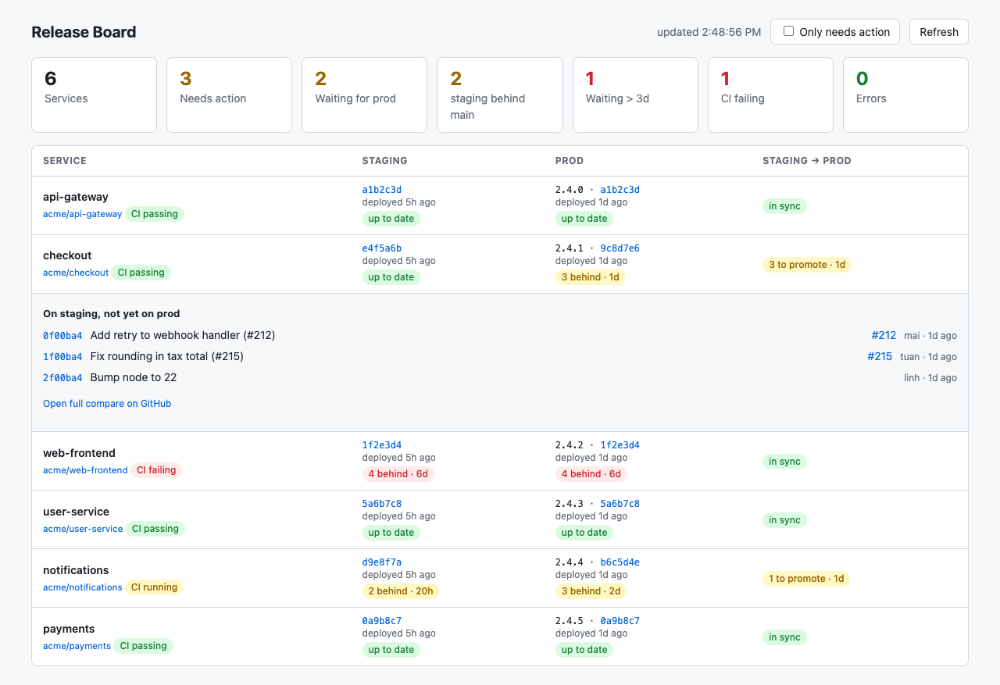

# Release Board

A local web page that shows, for each service:

- which image/commit is deployed to **staging / prod**,
- how many commits each environment is **behind the default branch**,
- how many commits are in staging but **not yet promoted** to prod, and how long they have waited,
- the commits and PRs behind each number (click a badge), when each environment was deployed, and CI on the default branch.



It reads the kustomize image patches in your GitOps repo (e.g. `overlays/prod/patches/images.yaml`) through the GitHub API. Tags like `staging-15adc1d` give the commit directly; version tags like `3.5.6` are traced back through the GitOps repo history to the staging image they were promoted from. Nothing is stored; the token stays on your machine.

## Let your AI agent set it up

Open the repo in Claude Code, Codex, Cursor or similar and ask: *"set up release-board for our GitOps repo"*.
[AGENTS.md](AGENTS.md) tells the agent how to find your image patch files, map deployments to repos,
and write `config.yml` and `.env` for you.

## Run

Needs Node 20.11+.

```bash
git clone <this repo> && cd release-board
npm install
cp config.example.yml config.yml   # list your repos + environment names
cp .env.example .env               # add GITHUB_TOKEN
npm start
```

Open http://localhost:3000.

### Docker

```bash
docker run --rm -p 127.0.0.1:3000:3000 --env-file .env \
  -v "$PWD/config.yml:/config/config.yml:ro" ghcr.io/congthiendev/release-board
```

Or build it yourself: `docker build -t release-board .`

Keep the `127.0.0.1:` prefix: the container holds your token.

Data is cached for 60 s; the page auto-refreshes.

## Requirements for your repos

- One patch file per environment, with one Deployment per service and the image on its first container.
- Image tags end in the commit sha (`staging-<sha>`, `main-<sha>`), or are copied from `promotedFrom` by a promote commit.
- The token needs read access (Contents) to the GitOps repo and every service repo (fine-grained token, or classic `repo`).

## Limits

- The "Not promoted" column compares only the last two environments in `config.yml`.
- A version tag is resolved only if its promote commit is within the last 100 commits to that patch file; otherwise it shows "commit unknown".
- The server listens on 127.0.0.1 by default (`HOST` overrides it, the Docker image sets `0.0.0.0`).

## Test

```bash
npm test   # uses a fake GitHub API, no token needed
```

## License

MIT
